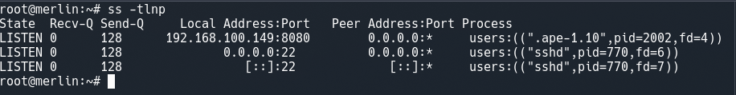
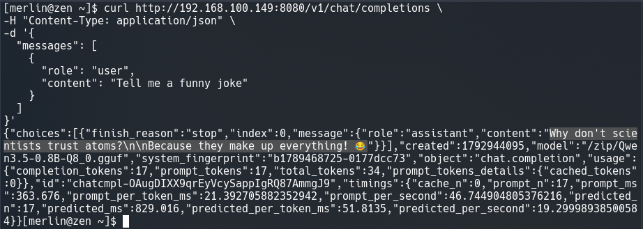
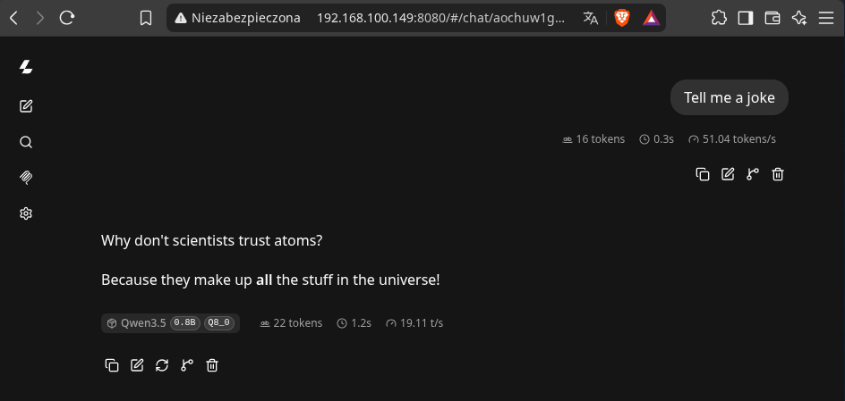

# Dokumentacja: Wdrożenie modelu llamafile jako usługi systemd

Zadanie polega na uruchomieniu gotowego modelu uczenia maszynowego w postaci pliku llamafile jako usługę systemd na maszynie wirtualnej z systemem Linux. 

## 1. Przygotowanie środowiska i pobranie modelu

Rozpoczęto od nawiązania połączenia z maszyną wirtualną (z systemem Debian) oraz pobrania pliku wykonywalnego modelu do dedykowanego katalogu. Wybrano model Qwen3.5.

*   `ssh merlin@192.168.100.149`
    Zdalne logowanie na maszynę wirtualną przez protokół SSH.
*   `sudo mkdir /opt/llamafile`
    Utworzenie katalogu dla usługi.
*   `sudo curl -L -o /opt/llamafile/model.llamafile https://huggingface.co/mozilla-ai/llamafile_0.10/resolve/main/Qwen3.5-0.8B-Q8_0.llamafile`
    Pobranie modelu językowego.
    *   **Flaga `-L` (Location):** Wymusza podążanie za przekierowaniami HTTP.
    *   **Flaga `-o` (Output):** Zapisuje pobrany strumień danych pod wskazaną nazwą i ścieżką na dysku.

## 2. Konto oraz uprawnienia

Utworzono dedykowanego użytkownika z ograniczonymi uprawnieniami oraz nadano odpowiednie prawa do plików.

*   `sudo useradd --system --no-create-home llamafile`
    Utworzenie konta usługowego.
    *   **Flaga `--system`:** Tworzy konto systemowe (bez możliwości standardowego logowania na powłokę).
    *   **Flaga `--no-create-home`:** Zapobiega tworzeniu zbędnego katalogu domowego w `/home/`.
*   `sudo chmod +x /opt/llamafile/model.llamafile`
    *   **Flaga `+x` (Executable):** Nadaje plikowi modelu atrybut wykonywalności, traktując go jako program.
*   `sudo chown -R llamafile:llamafile /opt/llamafile`
    Przekazanie własności katalogu nowemu użytkownikowi.
    *   **Flaga `-R` (Recursive):** Rekursywnie zmienia właściciela dla całego katalogu docelowego i wszystkich plików wewnątrz.

## 3. Konfiguracja systemd

*   `sudo nano /etc/systemd/system/llamafile.service`
    Utworzenie pliku jednostki usługi. Zawartość pliku:

    ```ini
    [Unit]
    Description=unit
    After=network-online.target
    Wants=network-online.target

    [Service]
    User=llamafile
    Environment="HOME=/opt/llamafile"
    ExecStart=/bin/sh /opt/llamafile/model.llamafile --server --host 192.168.100.149 --port 8080
    Restart=on-failure

    [Install]
    WantedBy=multi-user.target
    ```

*   `sudo systemctl daemon-reload`
    Wymuszenie ponownego wczytania konfiguracji.

## 4. Uruchomienie

Uruchomiono serwer AI oraz sprawdzono poprawność jego działania.

*   `sudo systemctl start llamafile`
    Uruchomienie usługi.
*   `sudo systemctl enable llamafile`
    Dodanie usługi do autostartu .
*   `sudo journalctl -u llamafile -f`
    Podgląd logów usługi.
    *   **Flaga `-u` (Unit):** Filtruje dziennik systemowy i wyświetla wyłącznie komunikaty dotyczące usługi `llamafile`.
    *   **Flaga `-f` (Follow):** Zostawia podgląd otwarty i na bieżąco wyświetla nowe logi.

## 5. Sprawdzenie portu oraz autostartu

*   **Nasłuchiwanie portu:**
    Wynik polecenia `sudo ss -tlnp`:
    

*   **Zużycie pamięci:**
    Wynik polecenia `sudo systemctl status llamafile`, zużycie pamięci (Memory) oraz działanie ponownego uruchomiena usługi po zabiciu procesu `sudo kill -9 <PID>` pod nowym identyfikatorem PID:
    
    
## 6. Test komunikacji REST API z gospodarzem (Host-only)

Wysłanie zapytania JSON z systemu gospodarza.

*   Zapytanie:
    ```bash
    curl http://192.168.100.149:8080/v1/chat/completions \
    -H "Content-Type: application/json" \
    -d '{
      "messages": [
        {
          "role": "user",
          "content": "Tell me a funny joke"
        }
      ]
    }'
    ```
    *   **Flaga `-H` (Header):** Określa nagłówek zapytania HTTP (informuje, że dane to JSON).
    *   **Flaga `-d` (Data):** Wskazuje ładunek (payload) przesyłany w treści zapytania POST.

*   Odpowiedź modelu:
    

## 7. (Dodatkowo) Test w przeglądarce

Model działa również w przeglądarce pod adresem 192.168.100.149:800 z możliwością wpisania zapytania w postaci chatu.
